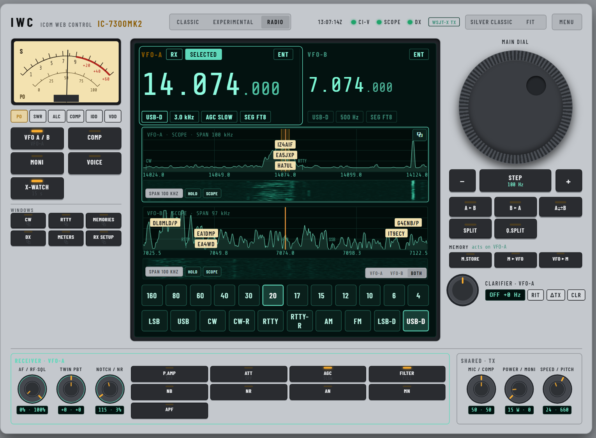

# Icom Web Control

> **v1.6.0 — current release.** **[Download the latest installer](https://github.com/mm5agm/Icom_Web_Control/releases/latest)** | [User manual](USER_MANUAL.md) | [Discussions](https://github.com/mm5agm/Icom_Web_Control/discussions) | [Website](https://mm5agm.co.uk)

Icom Web Control (IWC) runs an **Icom IC-7300** or **IC-7300 MkII** from a browser on your PC, tablet or phone: frequency and mode, meters, PTT, band, VFO and split, the RX DSP, the CI-V spectrum scope, the ATU, CW, RTTY and voice control. It is free and open source, it runs on your own PC, and it needs no SDR because the radio streams its scope over CI-V. It is the sister program to my [Yaesu Web Control](https://github.com/mm5agm/Yaesu_Web_Control) (YWC). The two are separate programs: YWC stays Yaesu-only, and IWC stays Icom-only.

## Why this application exists

I can't see my radio's controls without a magnifying glass, and Icom has tucked a lot of the IC-7300's controls away on touchscreen menu pages. I find getting to the page I want a bit hit-and-miss. The Classic page was written specifically with partially sighted operators in mind, so that they can operate the radio with a screen reader and voice control.

## What it does

**Four views of the radio**

- **[Classic](USER_MANUAL.md#5-main-control-panel)**: everything on one page, made for [NVDA and Windows Narrator](USER_MANUAL.md#16-accessibility-and-screen-readers), with [voice control](USER_MANUAL.md#17-voice-control) and [spoken announcements](USER_MANUAL.md#516-voice-announcements).
- **[Radio panel](USER_MANUAL.md#520-radio-panel)**: laid out like the front of a radio, with working keys, knobs and a main dial, in several themes.
- **[Experimental UI](USER_MANUAL.md#519-experimental-ui)**: a workspace of dockable panels, designed by Fabio Valente (CR7CDC) for Yaesu Web Control.
- **[RTTY Contest](USER_MANUAL.md#521-rtty-contest)**: only what a contest RTTY operator uses, on one screen. *Still being tested.*

**See the band**

- **[The radio's scope and waterfall](USER_MANUAL.md#54-spectrum-display)** in the browser, for VFO A and VFO B even on different bands. X-Watch looks at the other band every few seconds, and one click turns it off during a QSO.
- **[DX spots](USER_MANUAL.md#517-dx-spots-list)** on the spectrum, and a [watch list](USER_MANUAL.md#514-dx-watch-panel) that alerts you when a callsign or prefix appears.

**Operate**

- **[CW Reader](USER_MANUAL.md#18-cw-reader)** prints the Morse in the radio's receive audio as text, with no extra hardware. On a strong, clean signal it is close to perfect. On a marginal one it prints plausible rubbish, so the status line says what it is actually hearing, nothing is corrected or hidden, and the log form offers a callsign rather than filling it in.
- **[CW Send](USER_MANUAL.md#19-cw-send)**: type a line, press Enter, and the radio keys it. Stop or Escape halts it at once. It has yet to be exercised on air by a CW operator, so feedback is welcome.
- **[CW Paddle](USER_MANUAL.md#21-cw-paddle)** sends from your own paddle when the radio is somewhere else, through a HaliKey MIDI or an ESP32-S3 board and three wires. *Still being tested: it has not yet keyed an IC-7300, so please tell me how it goes.*
- **[RTTY tuner](USER_MANUAL.md#20-rtty)**: a crossed-ellipse tuning scope and text decode, and Auto measures shift and speed. RTTY is receive only: transmit from your logger, or from MMTTY.
- **[Voice control](USER_MANUAL.md#17-voice-control)**: say the band, mode or frequency. Recognition runs locally, with no cloud service.
- **[Memory banks](USER_MANUAL.md#8-radio-memories)**, **[pop-out windows](USER_MANUAL.md#518-pop-out-windows)** for a second monitor, **[the radio's own menu to a file and back](USER_MANUAL.md#66-backup--restore)** on the MkII, and a **[rigctld bridge](USER_MANUAL.md#9-external-applications)** so WSJT-X and IWC share the radio.

## Supported radios

**`v1.6.0` is the current release.** Development and bench testing has been on one IC-7300 MkII, and an owner of an original IC-7300 has confirmed it on their radio. That is still only two radios, so if anything behaves unexpectedly on either, please report it.

- **IC-7300 MkII**: CI-V over USB Type-C, default address `B6`.
- **IC-7300** (original): CI-V over USB Type-B, default address `94`. It only streams its scope with **CI-V USB Port** set to **Unlink from [REMOTE]** and **CI-V USB Baud Rate** at **115200**. Confirmed by Gerry M9YKD ([#5](https://github.com/mm5agm/Icom_Web_Control/issues/5)). See [§15.7](USER_MANUAL.md#157-i-have-the-original-ic-7300-not-the-mkii--what-do-i-need-to-set-differently).

Other Icom CI-V radios (IC-705, IC-7610, IC-9700 and so on) share the same protocol family, and I'll add one if someone with the radio will test it. That means operating it and telling me what happens, not programming.

## Feedback

Please post anything you find, or a look you'd like to see, on [Discussions](https://github.com/mm5agm/Icom_Web_Control/discussions) or the [issues page](https://github.com/mm5agm/Icom_Web_Control/issues). Tablet testing has been limited, so feedback from tablet users is particularly welcome.

## ✨ Added since the last release

Everything in v1.6.0 is in the [v1.6.0 notes](#v160-2026-11-03) below, and earlier versions are in [RELEASE_HISTORY.md](RELEASE_HISTORY.md).

**Since v1.6.0**, in the code but not yet in a full release:

Nothing yet.

## 🔧 Fixed since the last release

One line per fix, newest first, with the build that has it. A pre-release installs exactly like a release and carries everything before it; each one is written up under [Release notes](#release-notes). *Not yet in a build* means the fix is in the code and will be in the next pre-release or release.

Nothing since v1.6.0 yet. Fixes up to v1.6.0 are in [RELEASE_HISTORY.md](RELEASE_HISTORY.md#fixes-up-to-v160).

## Releases and pre-releases

The [Download link](https://github.com/mm5agm/Icom_Web_Control/releases/latest) always gives you the newest full release. Entries marked **Pre-release** on the [releases page](https://github.com/mm5agm/Icom_Web_Control/releases) are my ongoing work: they have had less testing, and your feedback is what turns one into a full release. IWC's update banner only offers a pre-release if you are already running one.

## ⚠️ Windows Security Warnings on First Install

Because the installer is not code-signed, Windows and third-party antivirus tools treat it as an unknown, newly downloaded executable and may warn about it or block it. This is expected — the file is not malware. The installer is built by GitHub Actions directly from the source in this repository, and GitHub shows a SHA-256 digest beside each file on the release page — run `Get-FileHash Icom_Web_Control_Setup.exe` in PowerShell and the two should match. Follow whichever of these matches what you see:

**Microsoft Edge or Defender blocks the download, or Defender quarantines it, and says it contains a virus or "This program is dangerous and executes commands from an attacker"**
This is Defender's cloud/machine-learning classifier (the detection name ends in `!ml` — with v1.5.0 it was `Trojan:Win32/Wacatac.B!ml` on the installer itself, caught by Edge while it was still downloading). It is a false positive that hits many unsigned .NET applications, and it can appear on a build that scanned clean the day before. To recover:

- **If Edge blocked the download:** open Downloads (**Ctrl+J**), click **…** on the Icom Web Control entry, choose **Keep**, then **Show more → Keep anyway**.
- **If Defender quarantined it:** open **Windows Security → Virus & threat protection → Protection history**, click the entry, choose **Actions → Allow on device**, then download the installer again (or simply start IWC again if it was the installed program that was taken). Choose *Allow*, not just *Restore* — Restore puts the file back but Defender may take it again at the next scan.

Don't switch Defender off — allowing this one file is enough. If this happens to you, please post the detection name shown in Protection history in a [Discussion](https://github.com/mm5agm/Icom_Web_Control/discussions) or an issue; I report each one to Microsoft as a false positive, and that is what makes it stop happening for the next person.

**"Windows protected your PC" (SmartScreen) or an Unknown Publisher prompt when you run the installer**
Click **More info → Run anyway**.

**Norton (or other antivirus) flags the file as malware**
This is the same false positive, caused by the executable being unsigned and newly downloaded. In Norton, go to **Security → History**, find the quarantined file, and choose **Restore & Exclude** (or the equivalent Allow option in your antivirus).

**Right-click → Properties → Unblock**
Windows marks files downloaded from the internet as untrusted. Before running the installer, right-click the file, choose **Properties**, and if you see an **Unblock** checkbox at the bottom of the General tab, tick it and click OK.

**"This app can't run on your PC" — Smart App Control**
If Smart App Control is enabled it will block unsigned apps entirely. Go to **Settings → Privacy & Security → Windows Security → App & Browser Control → Smart App Control** and switch it to **Off**, then restart your PC and try again.

The screenshot below shows the Smart App Control setting:

These are one-time steps — once the app is installed you won't see them again.

## ⚠️ Warning

**IWC keys your transmitter.** It has been developed and bench-tested against a single IC-7300 MkII by one operator, with one original IC-7300 confirmed working by its owner — yours may be the third radio it has ever seen. It uses only the official Icom CI-V commands as documented, but no software is bug-free and **you use it entirely at your own risk.**

- **Test into a dummy load first.** Confirm transmit, power, and mode behave before you put a signal on air.
- **Always verify transmit frequency, power level, and mode** before transmitting — do not assume the app and the radio agree.
- **If Voice control is enabled it keys the radio.** A misheard command can start a transmission; keep an eye (and ear) on the radio's TX state.
- **Memory operations can overwrite your transceiver's memories.** Read the Settings and the memory functions carefully before saving to the radio.

If something looks wrong, stop transmitting and check the radio's own display. Please report anything you find on the [GitHub issues page](https://github.com/mm5agm/Icom_Web_Control/issues).

## Privacy

Icom Web Control runs on your own PC and does not send your data anywhere. It makes only these network connections:

- Between your browser and the PC it runs on, on your own network, for the web interface.
- From your browser to GitHub (api.github.com), to see whether a newer release exists. It reads the release list; nothing about you or your station is sent. See [GitHub's privacy statement](https://docs.github.com/site-policy/privacy-policies/github-general-privacy-statement).
- To a DX cluster, only if you turn DX spots on and enter a cluster yourself. It logs in with the callsign you enter, as every DX cluster requires.

## Staying informed about updates

IWC shows a banner the first time you run it after a new full release. To hear about a release outside the app (both of these include pre-releases):

- **GitHub:** on [the repository page](https://github.com/mm5agm/Icom_Web_Control), choose **Watch**, then **Custom**, and tick only **Releases**.
- **RSS / Atom:** subscribe to https://github.com/mm5agm/Icom_Web_Control/releases.atom in your feed reader.

## Release notes

**Only the version you are installing is listed here.** Earlier releases are in
[RELEASE_HISTORY.md](RELEASE_HISTORY.md); their installers are still on the
[releases page](https://github.com/mm5agm/Icom_Web_Control/releases).

### v1.6.0 (2026-11-03)

> **A full release.** Download `Icom_Web_Control_Setup.exe` below and install it over the top — nothing to uninstall first, and your settings, memories, calibration and voice phrases are all kept. It includes everything in the v1.6.0 pre-releases, whose notes are in [RELEASE_HISTORY.md](RELEASE_HISTORY.md). Like v1.5.0 it is unsigned, and Edge or Defender may flag it; the README's Windows Security section says what to do.

**The headline is RTTY Contest and the CW Paddle.**

- **RTTY Contest, a GUI for RTTY contesting** *(still being tested)*. Only what a contest RTTY operator uses, on one screen: the frequency, band keys that land on each band's RTTY spot, the radio's scope over its waterfall, and the RTTY tuner docked at the side with its decoded text. **MODE** holds the radio in the RTTY mode you choose and turns amber when it is in another. A tuning dial (outer ring for big steps, inner knob for small ones) shares a place with the decoded text. **MEM** lists your memories, **MONI** sets the monitor, **WIDTH** and **AUTO** set the filter, and **FIXED** holds the spectrum still and turns a page at the edge. **MENU** opens Settings and the other pages in a new tab, and the page has its own theme list. Each part pops out into a window of its own, and named layouts put every window back on its own monitor. It is the page from Yaesu Web Control, shared between the two apps, and much of it came from Bruce VK2RT's testing there. Receive only: transmit from your logger, or from MMTTY. User Manual, [§5.21](USER_MANUAL.md#521-rtty-contest).

- **CW Paddle** *(new and still being tested)*. Send CW from your own paddle when you operate the radio remotely. The paddle goes into a USB adapter that shows up as a MIDI device: a **HaliKey MIDI**, or an **ESP32-S3 board** that you program from the page with one button. The keyer and sidetone run in the browser, and IWC keys the radio by DTR: through the CI-V port on an original IC-7300, or the second USB port on an IC-7300MK2. It starts in dry run every time, so you can practise without transmitting; choosing a key line can put the radio in transmit at once. What you send shows in the CW Send log, on lines tagged *paddle*. **Enable HTTPS** in Settings lets a browser on another computer use the adapter. Tested in Yaesu Web Control on an FTdx101MP; it has not yet keyed an IC-7300, so please tell me how it goes. At the radio, plug the paddle into its KEY jack as usual. User Manual, [§21](USER_MANUAL.md#21-cw-paddle).

- **RTTY.** Settings → **RTTY mode** chooses RTTY-L, RTTY-U, DATA-L or DATA-U, and the tuner goes to that exact mode and holds it. In RTTY-R the tones are the right way up now; **Auto** never changes the radio's RTTY menu shift; **From radio** and **Auto** stay in the heading with **Tones only**; and the scope's arms straighten at the same dial setting. IWC keeps the tuner's last Mark and Shift. User Manual, [§20](USER_MANUAL.md#20-rtty).

- **Radio power at start and exit.** **Turn the radio on when Icom Web Control starts** (on by default) and **Turn the radio off when Icom Web Control closes** (off by default), in Settings.

- **Save in the CW Reader.** A **Save** button writes the text in the panel to a `.txt` file headed with the UTC time. Asked for by diane903 ([Discussion #86](https://github.com/mm5agm/Icom_Web_Control/discussions/86)). User Manual, [§18.5](USER_MANUAL.md#185-the-panel-controls).

- **X-Watch.** An **X-Watch** key beside the **Listening** badge, and an **X-WATCH** key on the Radio panel, switch cross-band watch on and off, so the peek no longer chops a QSO, and carry the peek interval. With X-Watch off the useless watch panel is hidden, and with it on and the VFOs on different bands the watch pane shows its trace without the empty waterfall. User Manual, [§5.4](USER_MANUAL.md#54-spectrum-display).

- **Radio panel.** A **VOICE** key for voice control. A corner grip scales the panel to any size, and the main dial spins like a weighted knob (the idea is from the tuning dial in Brian Clark's IC-7300-Scope). The pop-out spectrum window tunes on a click or the mouse wheel and has the **SCOPE** settings on each pane. The other VFO's passband has its real width, and the **FILTER** key shows the slot and its width. User Manual, [§5.20](USER_MANUAL.md#520-radio-panel).

- **Views and menus.** One **Views** list on every page, and IWC starts in the view you used last. The Experimental UI has a **Menu**, and Fabio Valente's (CR7CDC) dark look and panels from Yaesu Web Control. A shortcut can open IWC straight on a page, e.g. `Icom_Web_Control.exe rtty-contest`. User Manual, [§5.1](USER_MANUAL.md#51-top-bar), [§5.19](USER_MANUAL.md#519-experimental-ui).

- **The radio's own menu to a file, and back (IC-7300MK2).** Settings → **Radio Menu** saves all 270 items of the radio's SET menu to an `.ini` file and loads a file back, sending only the items you tick. Items that affect transmitting start unticked. **Export full backup** saves into a Backups folder. User Manual, [§6.6](USER_MANUAL.md#66-backup--restore).

- **Fixed:** a radio reply with an extra FE byte in front was thrown away; cross-band watch never ran from the Radio panel; a popped-out CW or RTTY window was drawn twice; in USB-D and LSB-D the Radio panel drew the passband centred on the dial; the readout under the mouse went stale while the dial moved; a pop-out window on a short screen never kept its size; the VOX and PROC buttons did not follow the radio.

## Licence

GPL-3.0, the same as YWC. See [LICENSE](LICENSE).

---

*Colin Campbell, MM5AGM*
