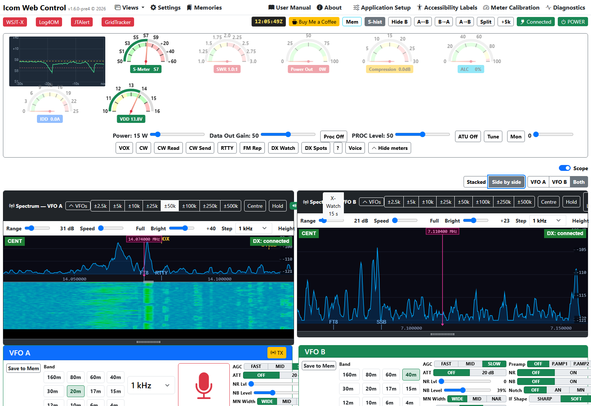

# Icom Web Control

> **v1.6.0 — current release.** **[Download the latest installer](https://github.com/mm5agm/Icom_Web_Control/releases/latest)** | [User manual](USER_MANUAL.md) | [Discussions](https://github.com/mm5agm/Icom_Web_Control/discussions) | [Website](https://mm5agm.co.uk)

Icom Web Control (IWC) runs an **Icom IC-7300** or **IC-7300 MkII** from a browser on your PC, tablet or phone: frequency and mode, meters, PTT, band, VFO and split, the RX DSP, the CI-V spectrum scope, the ATU, CW, RTTY and voice control. It is free and open source, it runs on your own PC, and it needs no SDR because the radio streams its scope over CI-V. It is the sister program to my [Yaesu Web Control](https://github.com/mm5agm/Yaesu_Web_Control) (YWC). The two are separate programs: YWC stays Yaesu-only, and IWC stays Icom-only.

## Why this application exists

I can't see my radio's controls without a magnifying glass, and Icom has tucked a lot of the IC-7300's controls away on touchscreen menu pages. I find getting to the page I want a bit hit-and-miss. The Classic page was written specifically with partially sighted operators in mind, so that they can operate the radio with a screen reader and voice control.

## What it does

**Four views of the radio**

- **[Classic](USER_MANUAL.md#5-main-control-panel)**: everything on one page, made for [NVDA and Windows Narrator](USER_MANUAL.md#16-accessibility-and-screen-readers), with [voice control](USER_MANUAL.md#17-voice-control) and [spoken announcements](USER_MANUAL.md#516-voice-announcements).
- **[Radio panel](USER_MANUAL.md#520-radio-panel)**: laid out like the front of a radio, with working keys, knobs and a main dial, in several themes.
- **[Experimental UI](USER_MANUAL.md#519-experimental-ui)**: a workspace of dockable panels, designed by Fabio Valente (CR7CDC) for Yaesu Web Control.
- **[RTTY Contest](USER_MANUAL.md#521-rtty-contest)**: only what a contest RTTY operator uses, on one screen. *Still being tested.*

**See the band**

- **[The radio's scope and waterfall](USER_MANUAL.md#54-spectrum-display)** in the browser, for VFO A and VFO B even on different bands. X-Watch looks at the other band every few seconds, and one click turns it off during a QSO.
- **[DX spots](USER_MANUAL.md#517-dx-spots-list)** on the spectrum, and a [watch list](USER_MANUAL.md#514-dx-watch-panel) that alerts you when a callsign or prefix appears.

**Operate**

- **[CW Reader](USER_MANUAL.md#18-cw-reader)** prints the Morse in the radio's receive audio as text, with no extra hardware. On a strong, clean signal it is close to perfect. On a marginal one it prints plausible rubbish, and the status line says what it is actually hearing.
- **[CW Send](USER_MANUAL.md#19-cw-send)**: type a line, press Enter, and the radio keys it. Stop or Escape halts it at once. It has yet to be exercised on air by a CW operator, so feedback is welcome.
- **[CW Paddle](USER_MANUAL.md#21-cw-paddle)** sends from your own paddle when the radio is somewhere else, through a HaliKey MIDI or an ESP32-S3 board and three wires. *Still being tested: it has not yet keyed an IC-7300, so please tell me how it goes.*
- **[RTTY tuner](USER_MANUAL.md#20-rtty)**: a crossed-ellipse tuning scope and text decode, and Auto measures shift and speed. RTTY is receive only: transmit from your logger, or from MMTTY.
- **[Voice control](USER_MANUAL.md#17-voice-control)**: say the band, mode or frequency. Recognition runs locally, with no cloud service.
- **[Memory banks](USER_MANUAL.md#8-radio-memories)**, **[pop-out windows](USER_MANUAL.md#518-pop-out-windows)** for a second monitor, **[the radio's own menu to a file and back](USER_MANUAL.md#66-backup--restore)** on the MkII, and a **[rigctld bridge](USER_MANUAL.md#9-external-applications)** so WSJT-X and IWC share the radio.

## Release notes

**v1.6.0 brings RTTY Contest and the CW Paddle.** RTTY Contest is a screen for RTTY contesting, shared with Yaesu Web Control, and every part of it can go to a window of its own on another monitor. Much of it came from Bruce VK2RT's testing there. The CW Paddle sends CW from your own paddle when you operate the radio remotely, through a HaliKey or an ESP32-S3 board you program from the page. Both are still being tested, and the paddle has not yet keyed an IC-7300.

[All of v1.6.0](RELEASE_HISTORY.md#v160-2026-11-03) | [Every earlier version](RELEASE_HISTORY.md) | [Installers](https://github.com/mm5agm/Icom_Web_Control/releases)

## Supported radios

**`v1.6.0` is the current release**. Development and bench testing has been on one IC-7300 MkII, and an owner of an original IC-7300 has confirmed it on their radio. That is still only two radios, so if anything behaves unexpectedly on either, please report it.

- **IC-7300 MkII**: CI-V over USB Type-C, default address `B6`.
- **IC-7300** (original): CI-V over USB Type-B, default address `94`. It only streams its scope with **CI-V USB Port** set to **Unlink from [REMOTE]** and **CI-V USB Baud Rate** at **115200**. Confirmed by Gerry M9YKD ([#5](https://github.com/mm5agm/Icom_Web_Control/issues/5)). See [§15.7](USER_MANUAL.md#157-i-have-the-original-ic-7300-not-the-mkii--what-do-i-need-to-set-differently).

Other Icom CI-V radios (IC-705, IC-7610, IC-9700 and so on) share the same protocol family, and I'll add one if someone with the radio will test it. That means operating it and telling me what happens, not programming.

## Feedback and updates

Please post anything you find, or a look you'd like to see, on [Discussions](https://github.com/mm5agm/Icom_Web_Control/discussions) or the [issues page](https://github.com/mm5agm/Icom_Web_Control/issues). Tablet testing has been limited, so feedback from tablet users is particularly welcome.

The [Download link](https://github.com/mm5agm/Icom_Web_Control/releases/latest) always gives you the newest full release, and IWC shows a banner the first time you run it after one. Pre-releases on the [releases page](https://github.com/mm5agm/Icom_Web_Control/releases) have had less testing, and your feedback is what turns one into a full release. The banner only offers a pre-release if you are already running one.

To hear about a release outside the app, pre-releases included, choose **Watch**, **Custom**, **Releases** on [the repository page](https://github.com/mm5agm/Icom_Web_Control), or subscribe to [the releases feed](https://github.com/mm5agm/Icom_Web_Control/releases.atom).

## ⚠️ Windows Security Warnings on First Install

The installer is not code-signed, so Windows and antivirus tools may warn about it or block it. It is built by GitHub Actions from the source in this repository, and the release page shows a SHA-256 digest for each file that you can compare with `Get-FileHash`.

- **Edge blocks the download:** press **Ctrl+J**, click **…** on the entry, choose **Keep**, then **Show more → Keep anyway**.
- **Defender says it contains a virus or "This program is dangerous":** a false positive. Open **Windows Security → Protection history**, click the entry and choose **Actions → Allow on device**, not just Restore. Then download again, or start IWC again.
- **Norton or another antivirus flags it:** the same false positive. Choose **Restore & Exclude**, or its equivalent.
- **"Windows protected your PC":** click **More info → Run anyway**.
- **"This app can't run on your PC":** that is Smart App Control, which has to be switched off.

These are one-time steps. The full detail is in [the manual, §2](USER_MANUAL.md#2-installation).

## ⚠️ Warning

**IWC keys your transmitter.** It has been developed and bench-tested against a single IC-7300 MkII by one operator, with one original IC-7300 confirmed working by its owner — yours may be the third radio it has ever seen. It uses only the official Icom CI-V commands as documented, but no software is bug-free and **you use it entirely at your own risk.**

- **Test into a dummy load first.** Confirm transmit, power, and mode behave before you put a signal on air.
- **Always verify transmit frequency, power level, and mode** before transmitting — do not assume the app and the radio agree.
- **If Voice control is enabled it keys the radio.** A misheard command can start a transmission; keep an eye (and ear) on the radio's TX state.
- **Memory operations can overwrite your transceiver's memories.** Read the Settings and the memory functions carefully before saving to the radio.

If something looks wrong, stop transmitting and check the radio's own display. Please report anything you find on the [GitHub issues page](https://github.com/mm5agm/Icom_Web_Control/issues).

## Privacy

Icom Web Control runs on your own PC and does not send your data anywhere. It makes only these network connections:

- Between your browser and the PC it runs on, on your own network, for the web interface.
- From your browser to GitHub (api.github.com), to see whether a newer release exists. It reads the release list; nothing about you or your station is sent. See [GitHub's privacy statement](https://docs.github.com/site-policy/privacy-policies/github-general-privacy-statement).
- To a DX cluster, only if you turn DX spots on and enter a cluster yourself. It logs in with the callsign you enter, as every DX cluster requires.

## Licence

GPL-3.0, the same as YWC. See [LICENSE](LICENSE).

---

*Colin Campbell, MM5AGM*
